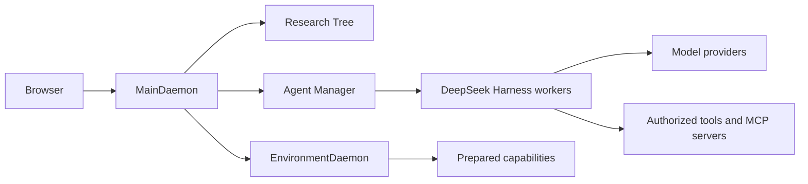

# Architecture

Polariton is a local application with a browser interface and two peer processes.
`npm start` launches both and opens the browser. The source checkout contains
application code; persistent user data lives in [OS data directories](STORAGE.md).

## Ownership

| Component | Owns |
| --- | --- |
| MainDaemon | Local browser/API authentication and application composition |
| Research Tree | Graph records, independent node workspaces, Git checkpoints |
| Agent Manager | Worker identity, admission, lifecycle, permissions, environment assignments |
| EnvironmentDaemon | Capability definitions, immutable revisions, preparation, credentials, access grants |
| DeepSeek Harness | Model execution, tools, context, compaction, session history |
| Browser | Presentation, navigation, and graph layout |

Main and Environment persist separate records and recover independently.
An environment outage can make capabilities unavailable without removing research
projects or preventing ordinary conversation.

## Research and workers

A project contains a graph of research nodes. Relationships are descriptions,
not scheduling rules. Each node has an independent Git workspace. Multiple workers
can share its files while keeping distinct conversations and execution context.
The first worker has the same authority model as other workers.

A checkpoint captures workspace files and publishes a retained Git reference.
Publication coordinates concurrent captures, but does not freeze workers or
external editors. A successful capture covers a verified interval, not a global
atomic snapshot. Its publisher is not necessarily the author of every included file.

## Execution and history

A user message reaches Main through its authenticated API. Agent Manager admits
it for the selected worker, resolves its pinned environment, and delegates
execution to the Harness adapter. Harness talks to the model and authorized tools.
Worker IDs, Harness sessions, operating-system processes, and research nodes are
distinct identities; their histories must not be conflated.

DSH is the sole writer of execution history. Polariton reads saved records through
its Harness integration for conversation and trajectory views. Reading history
must not start an agent or create a model request.

## Capabilities

Registering a capability describes it. Applying an environment prepares selected
revisions; sending a message does not install infrastructure. Worker assignments
retain exact revisions so later edits cannot silently replace active tools.
DSH calls authorized MCP servers directly; Environment owns preparation and grants.
See [capability operations](ENVIRONMENT.md).

## Contributor boundaries

Keep upstream protocol and storage interpretation inside `harness/`. Application
code uses its public contracts. Browser code accesses adapted DSH presentation
through `presentation.ts` and `views.tsx`; keep the runtime and rendering boundary
separate. The build checks both boundaries and presentation provenance.

Use typed contracts, bounded operations, observable failures, and recoverable
mutation identities. Keep each state owner authoritative instead of duplicating
its records in another subsystem. Follow [development](DEVELOPMENT.md) when
changing these contracts.
